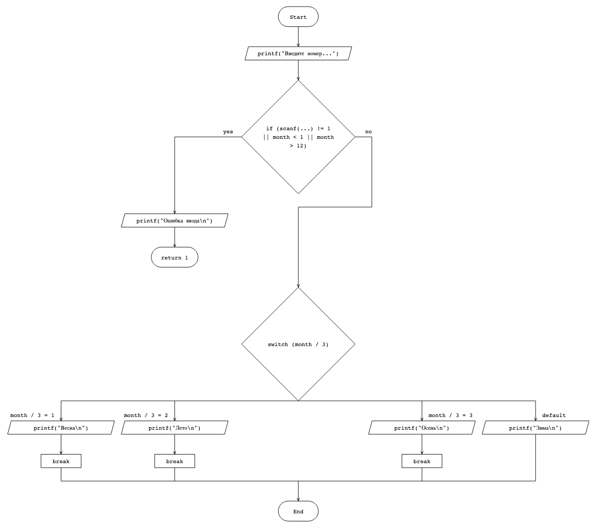
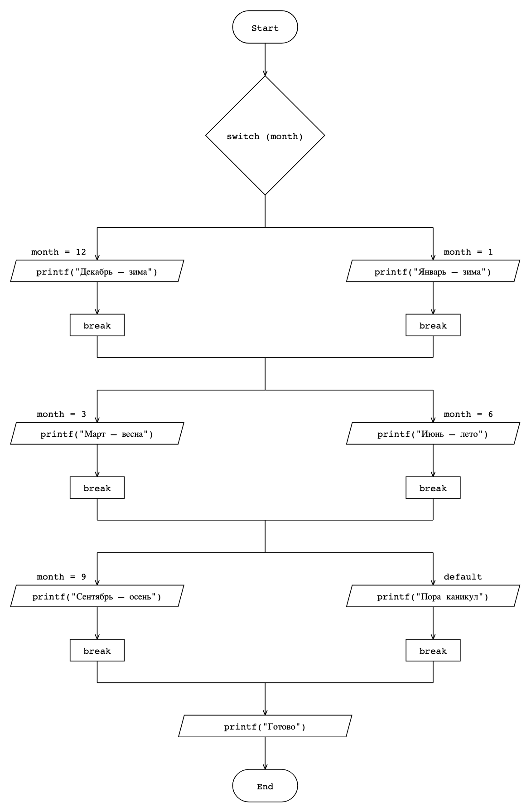

<div align="center">

# gostpadi

**Блок-схемы по ГОСТ 19.701 из кода на C и C++ — без рисования руками**

Скармливаешь `main.c` или `main.cpp` — получаешь готовую схему: линии
под 90° и одной толщины, стрелка на входе в каждый блок, длинные схемы
сами режутся на листы А4.

[](https://github.com/sehaxe/gostpadi/actions/workflows/rust.yml)
[](https://github.com/sehaxe/gostpadi/releases)
[](LICENSE)
[](https://sehaxe.github.io/gostpadi/)

[Установка](#установка) · [Использование](#использование) · [Сайт](#сайт)



</div>

## Зачем

Курсовые и лабы требуют схемы по ГОСТ, а рисовать их в редакторе — боль.
`gostpadi` делает это сам:

- **Из кода** — парсит C (`if`/`else`, `switch/case`, `while`/`for`/`do-while`,
  `return`, `printf`/`scanf`) и строит схему; **все функции файла** —
  у каждой своя схема (`main.c#add` → `main-add.svg`), файл без `main`
  тоже рисуется; понимает и практический C++ (`cin`/`cout`, `std::`,
  `using namespace std;`, ссылки, `string`);
- **В отчёт** — `--trim` даёт SVG ровно по содержимому в миллиметрах
  (вставляется в Word «миллиметр в миллиметр»), `--drawio` — тот же
  рисунок редактируемыми блоками;
- **С понятной ошибкой** — на синтаксисе движок пишет файл, строку и
  столбец, а не падает; C++-обвязка снимает `using`/`std::`/ссылки до
  C-грамматики;
- **По ГОСТ 19.701-90** — ромбы 45°, циклы шестиугольником «подготовка»,
  параллелограммы ввода-вывода, модульная сетка 5 мм;
- **В А4** — страница А4 с полями ЕСКД (30/10/20/20 мм); SVG обрезан по
  содержимому (максимум 155×237 мм), в документ он вставляется в масштабе
  пачки — поля добавляет вёрстка отчёта; длинные схемы режутся на листы
  с кружками-соединителями
  (`--no-split` — наоборот, вся схема одним листом в масштабе пачки);
- **Пачкой** — `gostpadi 1/*.c 2/*.c -o out/`: блоки во **всех** схемах
  одного размера, как и требуют правила оформления отчёта.

Единственный вход — файл с кодом на C или C++. Отдельного текстового
формата больше нет: он был промежуточным звеном внутри движка, и схема
проходила лишнюю сериализацию в текст и обратно.



## Установка

```bash
cargo install --git https://github.com/sehaxe/gostpadi
```

Или готовый бинарник под Linux / macOS / Windows —
в [релизах](https://github.com/sehaxe/gostpadi/releases).

Сборка из исходников:

```bash
git clone https://github.com/sehaxe/gostpadi && cd gostpadi
cargo build --release
# бинарник: target/release/gostpadi
```

## Использование

```bash
gostpadi main.c -o main.svg            # код C -> main.svg
gostpadi main.cpp -o main.svg          # код C++ -> main.svg
gostpadi 1/*.c 2/*.c -o out/           # пачка: каждой схеме свой .svg
gostpadi main.c --labels=ru            # надписи «начало/конец», «да/нет»
gostpadi main.c --check                # только проверка, без рисования
```

Результат — чистый векторный **SVG** (в Word/LaTeX/браузер без потерь).
Каждый лист — настоящий А4 210×297 мм с полями ЕСКД, содержимое
центрировано в текстовой зоне 170×257 мм.

**Пачка** — для отчёта из нескольких работ: каждой схеме рисуется свой
файл, но **размер фигур, масштаб и сам лист общие на всю пачку** — блоки
во всех схемах одинаковые (ГОСТ 19.701-90 п. 4.1.3), и все страницы
лабы совпадают до миллиметра. Одинаковые имена получают префикс папки:
`1/main.c -> 1-main.svg`.

```bash
gostpadi 1/*.c 2/*.c 3/*.c -o out/   # вся лаба: один лист, один масштаб
```

Если пачка не влезает в книжный лист, движок возьмёт альбомный
(297×210 мм) — но один на всю пачку, чтобы страницы совпадали. Флаг
`--landscape` задаёт ориентацию принудительно. Если масштаб всё равно
опустился ниже читаемого (0.22), утилита пишет предупреждение в stderr:
схему всё равно можно смотреть, но кегль будет мелким.

### Что понимается в коде

| конструкция | как рисуется |
|---|---|
| `printf` / `scanf` | параллелограмм ввода-вывода |
| присваивания, `x = expr` | прямоугольник «процесс» |
| `if / else if / else` | ромб, ветки «да/нет», каскад — вертикальным стволом |
| `switch / case / default` | ромб, кейсы на шине; большой (5+) — сеткой в 2 колонки |
| `while` / `for` / `do-while` | шестиугольник «подготовка» сверху и нижняя трапеция-«подготовка» с номером итерации; обратная стрелка не рисуется — начало и конец тела связывают одинаковые номера на трапециях (как в ГОСТ-примерах); у `do-while` в заголовке стоит `do while`, потому что в C условие проверяется после тела |
| `return` | скруглённый терминатор, конец ветки |
| `break` | обычный прямоугольник процесса, как в коде; рельса выхода из цикла не рисуется |
| `continue` | рельса к выходу нижней трапеции цикла (следующая итерация) |
| объявления переменных | с инициализатором — `a = 5`, без него выбрасываются |
| незнакомый синтаксис | блок с исходным текстом: `scanf_s`, макросы, опечатки не ломают схему |

`goto` не поддерживается: метка рисуется обычным блоком, переход — нет.

**C++ для лаб.** Файлы `.cpp`, `.cc`, `.cxx`, `.hpp`, `.hxx`, `.hh`
(и `.h`) идут через тот же движок. Понимаются `using namespace std;`,
`std::` и `ns::`-квалификаторы, `namespace X { ... }` (обёртка
снимается), `cin`/`cout`/`endl`, `bool`, `constexpr`, `auto`, `string`,
`std::string`/`size_t`/потоки, ссылки (`int &a`), `static_cast<T>(x)` и
инициализация `int x{}` / `int x{5}`. Классы, методы, шаблоны и
STL-контейнеры (`vector`, `map`, `std::function`), range-for и
default-аргументы не поддерживаются: это C-фронтенд с C++-обвязкой, а
не компилятор C++. Подписи блоков остаются исходными
(`int &a`, `string s`, `auto x`); `std::` в подписи опускается —
`cout << x` читается и без пространства имён.

**Ручной перенос.** Комментарий `// перенос` (отдельной строкой или в
хвосте кода) режет схему: следующая страница начинается с кружка-соединителя,
как при авторазрезе. В теле большого цикла тот же комментарий делит тело
между операторами. Последним оператором файла или тела маркер резать не на
чем — он глотается, лишнего листа не будет. В `.gvn` для этого
зарезервировано слово `перенос`, а на C-пути — имя `__gsplit__` (маркер
переписывается в `__gsplit__ ();`): своими блоками они уже не станут. Внутри
выключенного `#if 0` маркер не срабатывает — этот код в схему не попадает
вовсе. Внутри вложенного цикла маркер не работает: там разрез тела не
поддерживается.

**Авторазрез отдельных схем.** Целая схема не режется, если влезает на
лист А4 с масштабом не мельче 0.22 — даже если она длиннее рабочего
бюджета страницы. Разрез появляется только там, где иначе вышел бы
микрокегль: схема делится верх по 97% высоты листа, длинное тело цикла
режется между операторами.

**Ошибки с координатами.** Разбор идёт через `lang-c` (C11); на
синтаксической ошибке возвращается `ParseError` с файлом, строкой и
столбцом — без паники и без «пустого листа». C++-конструкции снимаются
нормализатором `frontend/cpp.rs` до C-грамматики: `using`, `std::`,
ссылки, `string`, `auto`, `constexpr`, brace-init и `static_cast`.

### Все опции

| опция | что делает |
|---|---|
| `-o ФАЙЛ/ПАПКА` | имя результата; для пачки — папка (или имя рядом с каждым входом) |
| `--labels=ru\|en` | язык надписей: «начало/конец» и «да/нет» или Start/End и yes/no (по умолчанию en) |
| `--font=N` | кегль текста в pt (по умолчанию 12), растит всю геометрию согласованно |
| `--lw=N` | толщина линий и усиков стрелок (по умолчанию 1.0) |
| `--no-split` | не резать длинную схему на листы: один лист без кружков-соединителей, в А4 его вписывает общий масштаб пачки (для вставки в отчёт — каждая схема на одной странице) |
| `--landscape` | альбомный лист А4 297×210 вместо книжного 210×297; на пачку влияет один раз |
| `--trim` | SVG ровно по содержимому, размер в миллиметрах, без листа А4 и без ужатия — для вставки в отчёт |
| `--drawio` | файл `.drawio` с редактируемыми блоками и рёбрами (правки в draw.io, а не картинка) |
| `--check` | проверить схемы: пересечения, наложения, один вход в «конец» |
| `-h, --help` | справка |
| `-V, --version` | версия |

## Сайт

**[sehaxe.github.io/gostpadi](https://sehaxe.github.io/gostpadi/)** —
лендинг; **[приложение](https://sehaxe.github.io/gostpadi/app.html)** — тот же
движок, что и в CLI, собранный в WASM: перетащи один или несколько
файлов — схемы рисуются прямо в браузере за миллисекунды, код никуда
не отправляется. Скачивание SVG и PNG, шеринг ссылкой на код.

Документация — **[sehaxe.github.io/gostpadi/docs/](https://sehaxe.github.io/gostpadi/docs/)**,
собирается из `site/` (Astro + Starlight, сборка на Bun).

## Как устроен движок

Rust, вывод — SVG без промежуточных растров. Конвейер:

```
код C/C++ → lang-c + C++-нормализатор → IR → перенос строк → раскладка
по модульной сетке → SVG с одним <g transform> на страницу
```

Парсер отдаёт узлы напрямую, без сериализации в текст: раньше C-путь
эмитил `.gvn` и тут же его парсил, и на этом терялись детали —
приходилось возвращать ключевое слово цикла в текст, чтобы парсер его
снял. Теперь у C, C++ и `.gvn` один общий IR и один контракт
`Frontend`. Перенос строк — общий шаг `gvn::wrap_nodes` перед
раскладкой: сколько символов влезет, зависит от `Style`.

Пересечения линий и наложения блоков исключаются инвариантами,
проверяемыми в тестах. Геометрия страницы живёт в `layout` и `Style`:
их спрашивают и порезка, и рендер, и они же решают, книжный лист или
альбомный. Формат чисел, сборка документа и записи в буфер — без
промежуточных аллокаций.

## Разработка

```bash
cargo test                                 # 281 тест: парсер, C++, раскладка, рендер, CLI
cargo clippy --all-targets -- -D warnings  # линтер
cargo fmt --check                          # форматирование
```

Сайт живёт в `docs/` и грузит `docs/gostpadi.wasm` — его пересобирает CI
на main автоматически. Локальная пересборка:

```bash
CARGO_PROFILE_RELEASE_OPT_LEVEL=z cargo build --release --lib \
  --target wasm32-unknown-unknown
cp target/wasm32-unknown-unknown/release/gostpadi.wasm docs/
```

Исходник веб-приложения — `web/` (`index.html`, `style.css`, `main.js`);
`docs/app.html` — собранный артефакт, его пересобирает
`node web/build.mjs` (CI делает это перед публикацией).

## Лицензия

MIT — [LICENSE](LICENSE).
